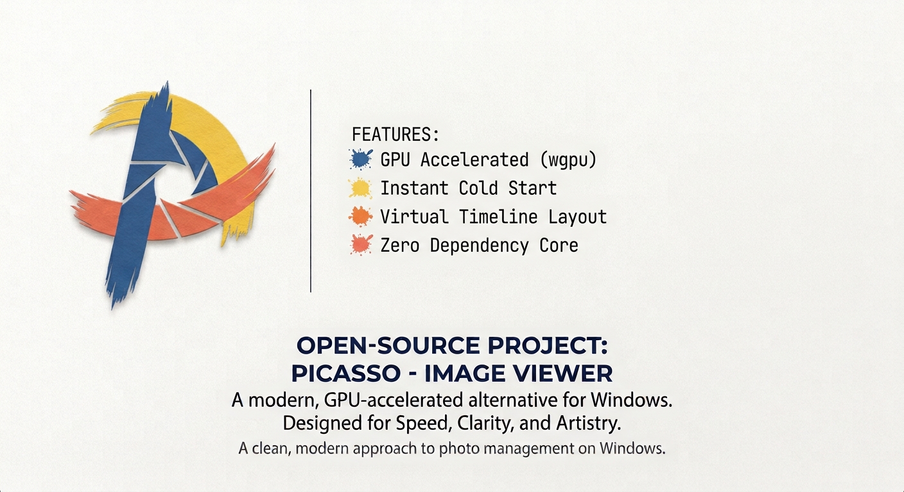
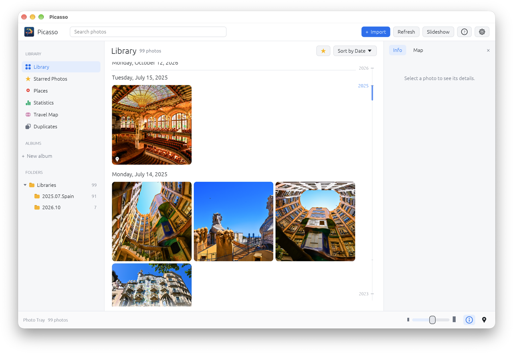
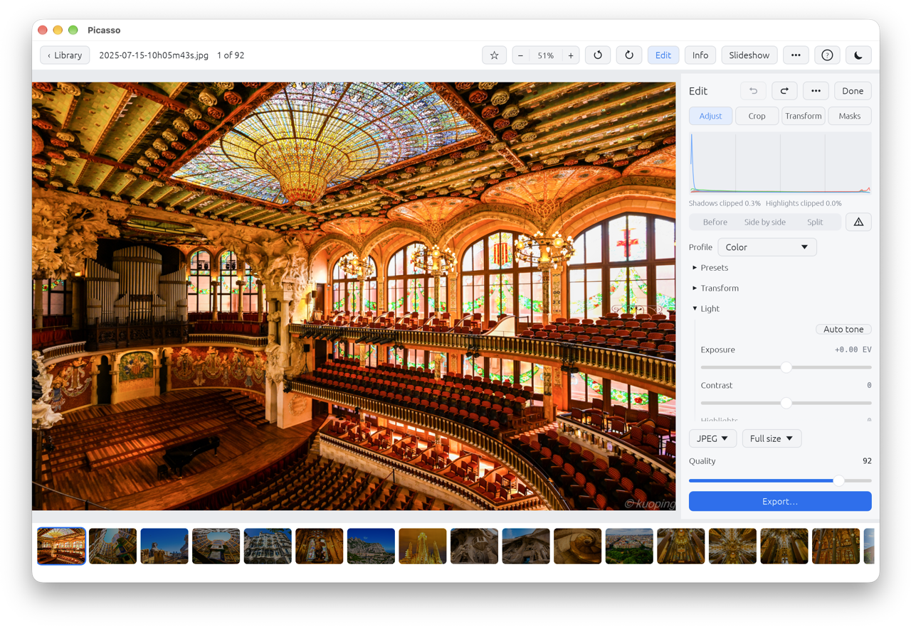
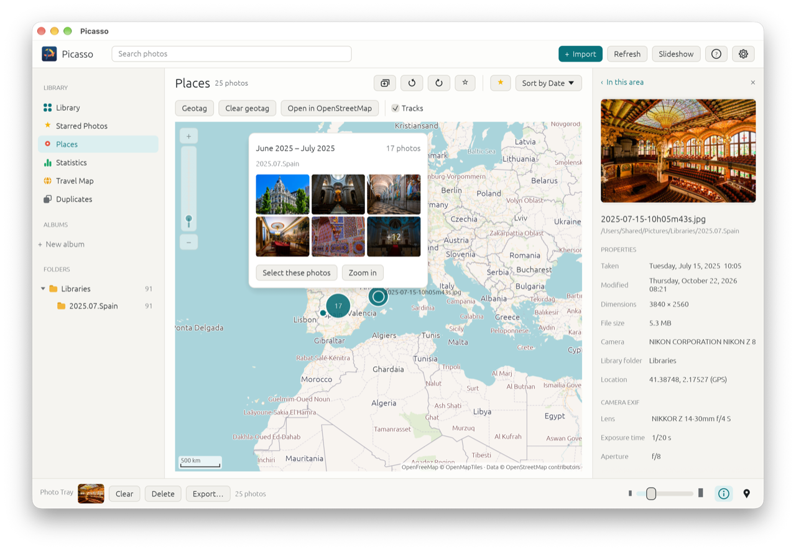
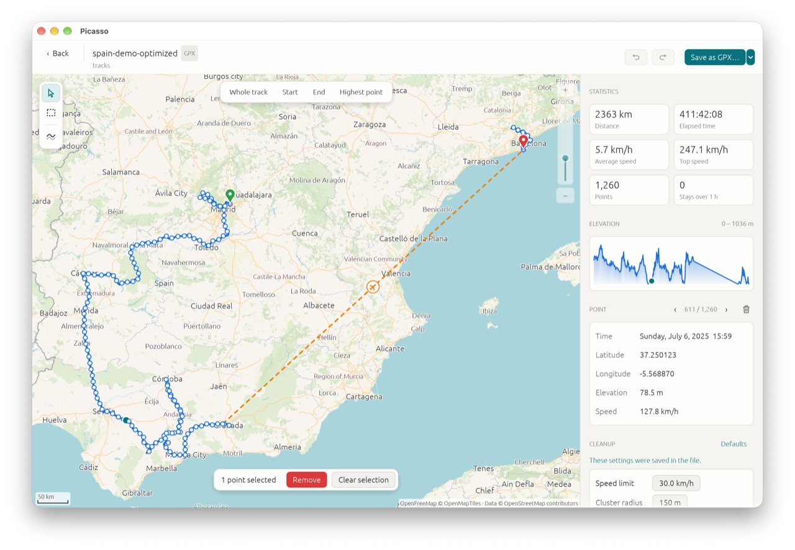
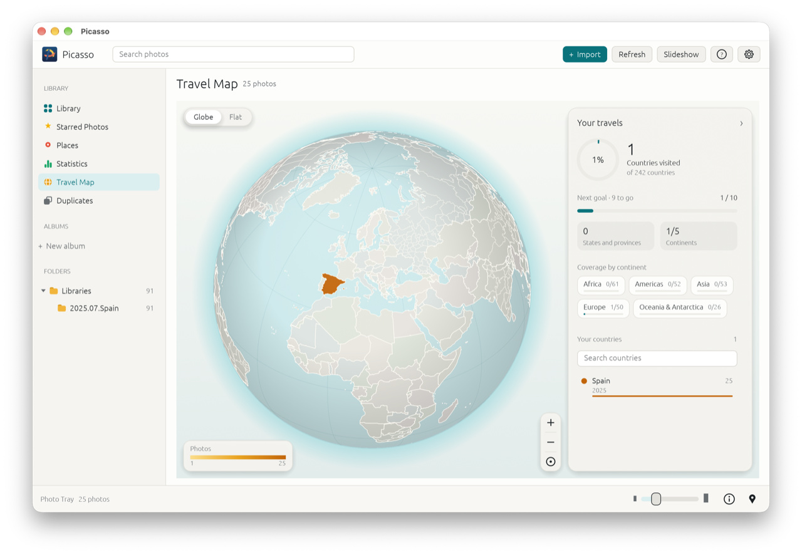
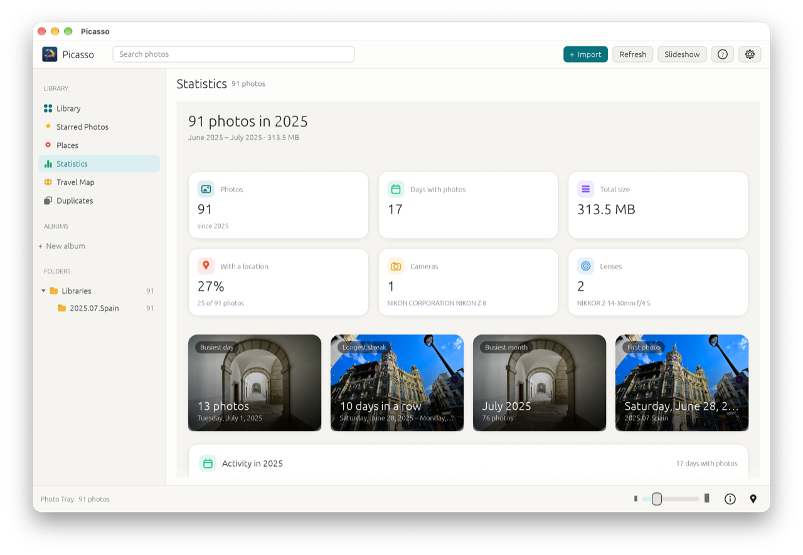

# Picasso

English | [繁體中文](README_zh-TW.md)



Picasso is a free, open-source photo library, viewer and editor for **Windows, macOS and Linux**. Organize photos in your existing folders, browse them by date or location, and edit them without changing the original files.

Inspired by Picasa, Picasso is written in Rust. It stores your library and edits locally. No cloud account is required, and photos and videos are not uploaded.

[Download](https://github.com/kuopinghsu/picasso/releases/latest) · [User guide](docs/USER_GUIDE.adoc) · [Release history](CHANGELOG.md)



## Contents

- [Features](#features)

- [Installation](#installation)

- [Getting started](#getting-started)

- [Configuration and data](#configuration-and-data)

- [Privacy and limitations](#privacy-and-limitations)

- [Documentation](#documentation)

- [Development](#development)

- [Releases](#releases)

- [Contributing](#contributing)

- [License](#license)

## Features

### Organize and find photos

- Browse a date-grouped thumbnail grid with folders, albums, captions and starred photos.

- Search by filename, folder path, caption, camera, lens or album. Combine a date with words, such as `2019-05 beach`.

- Use search filters such as `type:raw`, `gps:yes` and `is:edited`, exclude terms with `-`, and reuse recent searches.

- Rename photos and videos from a date or metadata pattern. Preview names before applying them and undo renames, including after restarting Picasso.

- Scan folders in the background and watch for changes. Import stars, captions and rotation from Picasa metadata files.

- Find duplicate files with content checks and SHA-256 verification. Review the results before moving unwanted copies to the system trash.

- View library statistics by date, camera, lens, focal length and location coverage.

### View, edit and export

- View photos with zoom, pan, a filmstrip, EXIF details, a histogram and a slideshow. Play videos with sound when FFmpeg is installed.

- Adjust light, tone curves, white balance, color, detail and effects. Use presets, crop, perspective correction, corner transforms and linear or radial masks.

- Filter edited photos independently of the sort order, and clear searches or filters directly from empty views.

- Keep edit history with undo, redo and before-and-after comparisons. Copy settings to other photos; crop and transform settings are excluded.

- Export edited copies as JPEG, PNG or TIFF, individually or in batches. Choose the output size and JPEG quality.



Copy an edited photo to the clipboard, copy file paths, or open a file in its default application. Slideshows support shuffle and fade transitions.

### Explore locations and GPS tracks

- Show photos with GPS coordinates in **Places**, using OpenFreeMap, OpenStreetMap, CARTO or Esri maps. Place photos manually or match their capture times to a GPS track. Search and star filters also apply in Places; select a track to find photos taken along it.

- Display GPX and KML tracks and Polarsteps JSON location exports. Edit track points, remove outliers, simplify paths and export a new GPX or KML copy.

- Use **Travel Map** to see countries and supported regions where your photos were taken. Its globe and flat map use built-in Natural Earth boundaries and work offline.









### Languages and appearance

The interface supports English, Traditional Chinese, Simplified Chinese, Japanese, Korean, German, Spanish, French, Italian and Brazilian Portuguese. Choose a language and a light, dark or system theme in **Settings → General**.

## Installation

Download a package from [GitHub Releases](https://github.com/kuopinghsu/picasso/releases/latest). Choose x64 for Intel or AMD systems, or Arm64 for 64-bit Arm systems. Release downloads also include English and Traditional Chinese PDF user guides and a SHA-256 checksum file.

### Windows

Supports Windows 10 and 11 on x64 and Arm64. Download the matching `.exe` and run it, or extract the `.zip` package. No installer is required.

### macOS

Supports macOS 11 or later on Apple silicon and Intel Macs. Open the `.dmg` and drag **Picasso** to **Applications**. The `.zip` provides the application bundle as an alternative.

Check the release notes for signing and notarization status. If an unnotarized build is blocked, try opening it once, then choose **Open Anyway** in **System Settings → Privacy & Security**.

### Linux

- **AppImage:** available for x64 and Arm64; targets Ubuntu 20.04, RHEL 8, Debian 10 and newer. Run `chmod +x <filename>.AppImage`, then open the file. If FUSE is unavailable, start it with `--appimage-extract-and-run`.

- **Debian package:** for Ubuntu 22.04 and newer. Install with `sudo apt install ./<filename>.deb`.

- **TAR archive:** built on Ubuntu 22.04. It includes the executable, desktop entry and icon for manual installation.

File dialogs use the XDG desktop portal, normally provided by the desktop environment. AppImages include application libraries, but require the system’s glibc and graphics driver.

### Optional video support

Video playback and thumbnails require both FFmpeg and ffprobe. Photos work without them. Install FFmpeg using the command for your system:

- Windows: `winget install Gyan.FFmpeg`

- macOS: `brew install ffmpeg`

- Debian or Ubuntu: `sudo apt install ffmpeg`

Picasso searches `PATH`, the application folder, common WinGet and Homebrew locations, and `PICASSO_FFMPEG` (a folder or the FFmpeg executable). For a portable setup, place both executables beside the app or in an `ffmpeg` subfolder.

## Getting started

1. Launch Picasso. On first launch, it adds your Pictures folder if available. Photos appear as the background scan progresses.
2. Use **+ Import**, or drag a folder onto the window, to add more folders. Picasso indexes files in place; it does not move them into a managed folder.
3. Select a photo and press **Enter** to view it, **E** to edit it or **S** to star it. Use albums and captions to organize your library.
4. Choose **Export…** to save an edited copy. Edits stay in the library until exported; the original file is unchanged.
5. Press **F1** or **?** for Help & Shortcuts. Press **F5** to rescan folders.

### Command-line usage

Pass photo folders to the executable, or use the geotag command to match photos to a track. These examples assume `picasso` is in your `PATH`; otherwise use its full path.

```sh
picasso ~/Pictures ~/Photos
picasso --version
picasso geotag track.gpx ~/Pictures/Trip --offset +01:00 --dry-run
picasso geotag --help
```

The geotag example previews matches without writing changes. Remove the dry-run option to save locations in the library and `.picasso-geotags.json` files beside the photos. Set the offset to the camera clock’s UTC offset.

## Configuration and data

Open **Settings** with the gear button. Configure language, theme, watched and excluded folders, file types, map sources, GPS track defaults and storage. **Settings → Storage** shows the actual data paths and provides cache and backup controls.

### Storage locations

The library is stored in `picasso.db`. Preferences are stored separately in `settings.json`. Default folders are:

- **Windows:** library `%APPDATA%\Picasso\picasso\data`; cache `%LOCALAPPDATA%\Picasso\picasso\cache`; settings `%APPDATA%\Picasso\picasso\config\settings.json`.

- **macOS:** library `~/Library/Application Support/app.Picasso.picasso`; cache `~/Library/Caches/app.Picasso.picasso`; settings `~/Library/Application Support/app.Picasso.picasso/settings.json`.

- **Linux:** library `~/.local/share/picasso`; cache `~/.cache/picasso`; settings `~/.config/picasso/settings.json`.

The cache contains thumbnails, map tiles and duplicate-search hashes. It can be cleared from Settings and rebuilt. A CARTO API key in the settings file is encrypted for the current computer; enter it again after moving the settings to another computer.

### Backups and recovery

At startup, Picasso creates a library backup if the latest backup is at least one week old, or if none exists. It keeps the five newest backups in a folder beside the database. Use **Settings → Storage** to create or restore a backup manually.

**Library backups do not include your photo and video files or the settings file.** Back up those files separately. Library backups include albums, stars, captions, edits and their history, presets and GPS tracks.

If the database cannot be opened, Picasso shows recovery options. A damaged library can be preserved and replaced with a readable backup or a new library. A busy or inaccessible library is not replaced. See the [user guide](docs/USER_GUIDE.adoc) for recovery steps.

Renaming history is stored in `.picasso-renames.json` beside your photos. Keep it with your media to retain the ability to undo earlier renames.

## Privacy and limitations

- **Network access:** photo browsing and editing work locally. Online maps download tiles; elevation lookup downloads terrain tiles for the track area. These requests reveal the requested map or terrain areas to the provider. Travel Map uses built-in boundaries and works offline.

- **Updates:** automatic update checks are enabled by default and contact GitHub at most once a day. Disable them in **Settings → General**. Updates are downloaded manually from the release page.

- **Original files:** photo edits, rotations and date corrections are stored in the library. GPS matching also writes sidecar files. Explicit file operations, such as renaming files or moving photos to the trash, affect the files on disk.

- **Formats:** supports JPEG, PNG, GIF, WebP, BMP, TIFF, HEIC/HEIF and camera RAW. Some unsupported RAW models use the camera’s embedded JPEG preview. Video requires FFmpeg and cannot be edited.

- **Editing scope:** no AI masks, healing, multi-image HDR merging, panorama stitching or lens profiles. HDR controls adjust a single photo.

- **Track import:** the library scanner supports GPX, KML and Polarsteps JSON. It does not index KMZ archives or area outlines.

## Documentation

- [User guide — English](docs/USER_GUIDE.adoc) and [Traditional Chinese](docs/USER_GUIDE_zh-TW.adoc): detailed workflows, shortcuts and troubleshooting.

- [Database](docs/DATABASE.md): library contents, schema versions and migrations.

- [Trips and Stories](docs/TRAVEL.md): how travel photos are organized into Trips and Stories, and the decisions behind it.

- [Testing](docs/TESTING.md): automated coverage and manual release checks.

- [Performance](docs/PERFORMANCE.md): benchmarks and external or network drive behavior.

- [Release procedure](docs/RELEASING.md) and [changelog](CHANGELOG.md).

## Development

### Build from source

Install Rust **1.95 or newer** and a C compiler; SQLite is built from source. On Windows, use Visual Studio Build Tools with **Desktop development with C++** and the Windows SDK. On macOS, install the command-line tools with `xcode-select --install`.

On Debian or Ubuntu, install the build dependencies:

```sh
sudo apt install build-essential pkg-config libasound2-dev libxkbcommon-dev libgl1-mesa-dev
```

On Fedora, install the corresponding packages:

```sh
sudo dnf install gcc pkgconf-pkg-config alsa-lib-devel libxkbcommon-devel mesa-libGL-devel
```

Run these commands from the repository root:

```sh
cargo build --release --locked
cargo run --release --locked -- ~/Pictures
cargo test --release --locked
```

The executable is `target/release/picasso` on macOS and Linux, or `target/release/picasso.exe` on Windows. Release builds provide better scanning, thumbnail and editing performance than debug builds.

OpenGL is the default renderer. Set `PICASSO_RENDERER=wgpu` to select the alternative wgpu renderer.

### Project structure

- Application views and workflows: [src/app/](src/app).

- Image processing and edit settings: [src/edit/](src/edit).

- Library storage, scanning and thumbnails: [src/db.rs](src/db.rs), [src/worker.rs](src/worker.rs) and [src/thumbs.rs](src/thumbs.rs).

- GPS tracks and geotagging: [src/track.rs](src/track.rs), [src/track_edit.rs](src/track_edit.rs) and [src/geotag.rs](src/geotag.rs).

- Translations: [src/i18n/](src/i18n) and language selection in [src/i18n.rs](src/i18n.rs).

### Checks and maintenance

The [Makefile](Makefile) provides build, test, benchmark, documentation and packaging commands. Run `make help` for all targets. Common commands are:

- `make check`: type-check the application and tests.

- `make lint`: run Clippy; warnings are reported but are not treated as errors.

- `make test`: run release-mode tests; use `make test T=backup` to select tests by name.

- `make check-docs`: verify documentation links, commands and settings against the source.

- `make ci`: check documentation and dependencies, run tests and check benchmark limits. Requires cargo-deny.

- `make guide` and `make guide-pdf`: build both user guides as HTML or PDF. Require Asciidoctor or Asciidoctor PDF and the fonts described in the Makefile.

CI builds and tests Windows and Linux packages on native x64 and Arm64 runners and creates a universal macOS application. It also checks Linux package installation and startup, AppImage compatibility, documentation and dependency licenses. See the [workflow](.github/workflows/ci.yml) for the complete checks.

## Releases

A version tag such as `v0.9.5` triggers publication. It must match the version in Cargo.toml and a dated section in CHANGELOG.md. Tags containing a hyphen are published as pre-releases. CI reads the changelog to generate release notes; it does not edit it.

Each release includes Windows executables and ZIP packages, Linux TAR, Debian and AppImage packages for both architectures, and macOS universal DMG and ZIP packages. It also includes two PDF guides, RAW decoder source and SHA-256 checksums. Packaged distributions include third-party license notices; the standalone Windows executable does not.

Follow [the release checklist](docs/RELEASING.md) before tagging. Published releases are immutable: correct a failed or incorrect release with a new patch version instead of moving a tag or replacing published files.

## Contributing

Bug reports, feature requests, documentation improvements and translations are welcome through [GitHub Issues](https://github.com/kuopinghsu/picasso/issues) and pull requests. Describe how to reproduce a problem and include the version shown in **About**. For code changes, run the relevant tests and documentation checks before submitting.

## License

Picasso is licensed under the [MIT License](LICENSE). Third-party dependencies have their own licenses. Generate their notices with `make notices`; release packages include the resulting notices file.
